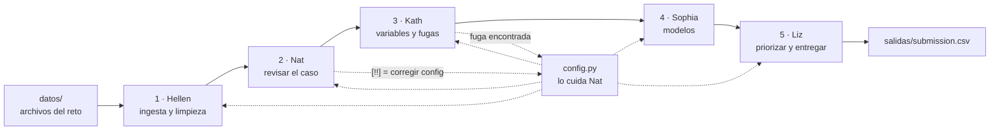

# Plantilla simple y editable · DataFest

De los archivos del reto a un **CSV de entrega**, en 5 pasos cortos (uno por persona):
ingesta y limpieza → revisión del caso → variables y fugas → modelos → priorización y entrega.

No es una caja negra para "correr y rezar". Está hecha para **editarse en el evento**:

- Lo que cambia entre retos vive en `config.py`, con ejemplos comentados de otros retos.
- Lo que hay que reprogramar está en **zonas marcadas** dentro de cada script:
  ```python
  # >>> EDITABLE ----------------------------------
  ...
  # <<< FIN EDITABLE ------------------------------
  ```
  Fuera de esas zonas, el código es el "motor": se lee para entenderlo, se toca solo con un motivo claro.
- Si algo del reto no aplica (no hay zona, ni cupos, ni lead, ni tablas de eventos), se pone `None` o `[]`
  y el paso se lo salta **sin caerse**.
- Si algo está mal escrito en la config, el paso 2 dice qué falta **y qué hay en su lugar**, antes de perder tiempo.

La guía detallada de cada integrante (qué hace, qué domina, qué edita, qué le preguntarán) está en
**[GUIA_EQUIPO.md](GUIA_EQUIPO.md)**.



---

## 1. Instalar y probar (una vez, 10 minutos)

```bash
python -m venv .venv
# Windows: .venv\Scripts\Activate.ps1      macOS/Linux: source .venv/bin/activate
pip install -r requirements.txt
python datos_practica.py --empresas 5000 --facturas 80000    # datos sucios de práctica en datos/
python correr_todo.py                                         # ~35 s -> salidas/reporte.html y salidas/submission.csv
```

Probada con Python 3.11 + DuckDB 1.1 y Python 3.13 + DuckDB 2.0 (mismos resultados).

## 2. Los archivos

| Archivo | Quién | Para qué | ¿Se edita? |
| --- | --- | --- | --- |
| `config.py` | Nat | Todo lo que cambia entre retos: tablas, fechas, target, cupos, entrega | **Sí, siempre** |
| `1_limpiar.py` | Hellen | Leer todo como texto, decidir tipos midiendo, limpiar, conciliar | Zona EDITABLE: reglas de tipo |
| `2_revisar_caso.py` | Nat | Comprobar que la config apunta a cosas que existen; el caso en números | Casi nunca |
| `3_variables.py` | Kath | Una fila por empresa, sin futuro; prueba de fuga | Zona EDITABLE: `AGREGACIONES`, `variables_extra()` |
| `4_modelo.py` | Sophia | Filtro de variables, candidatos, validación, importancia | Zona EDITABLE: `CANDIDATOS`, `metrica()` |
| `5_priorizar_entregar.py` | Liz | Monto, valor, elegibles, cupos, CSV final y controles | Zona EDITABLE: `monto_si_convierte()`, `elegibles()`, `priorizar()` |
| `correr_todo.py` | Nat | Corre 1→5, se detiene en el que falla, arma `salidas/reporte.html` | No |
| `comun.py` | todos | Funciones de limpieza en SQL (`txt`, `idn`, `num`, `fecha`), Gini, gráficos | Rara vez |
| `datos_practica.py` | — | Datos sucios de factoring para practicar | No |

Comandos útiles:

```bash
python correr_todo.py                      # todo
python correr_todo.py --desde 3            # desde el paso 3 (los anteriores ya corrieron)
python 4_modelo.py                         # un solo paso
python correr_todo.py --config config_b.py # otra configuración (dos personas probando dos ideas sin pisarse)
python correr_todo.py --solo-reporte       # rehacer el HTML
```

## 3. RECETAS: qué cambiar según el reto

Primero `python 1_limpiar.py`: imprime **todas** las tablas y columnas con su tipo. Con eso se llena la config.

### 3.1 Los datos vienen distintos

| Si el reto trae… | Cambien | Ejemplo |
| --- | --- | --- |
| Un Excel con título arriba / otra hoja | `OPCIONES_LECTURA` | `{"Reporte.xlsx": dict(hoja="Detalle", saltar_filas=3)}` |
| CSV separado por `;` o `\|` | `OPCIONES_LECTURA` | `{"tx.csv": dict(separador=";")}` |
| `train.csv` + `test.csv`, o un archivo por mes | `UNIR` | `{"base": ["train", "test"]}` (agrega `_origen`) |
| Una columna con el tipo equivocado (código como número) | `FORZAR_TIPO` | `{"maestro.codigo_ciiu": "texto"}` |
| Fechas mes/día (EE. UU.) | `FORMATOS_FECHA` | poner `"%m/%d/%Y"` primero |
| Otro código de "sin dato" (`-1`, `NO REGISTRA`) | `CENTINELAS_*` | agregar el valor |
| Otra moneda o tipo de cambio | `TIPO_CAMBIO`, `MONEDAS_USD` | `3.80`, `["USD", "DOL"]` |
| Filas idénticas que SÍ son válidas (sin id por fila) | `1_limpiar.py` | `QUITAR_DUPLICADOS = False` |

### 3.2 El target es distinto

| Si el enunciado… | Cambien | Ejemplo |
| --- | --- | --- |
| Define el target por eventos ("tomó factoring en los 6 meses siguientes") | `TARGET` forma A | `dict(tipo="evento", tabla="operaciones", filtro="estado <> 'ANULADA'")` |
| Da el target hecho (columna 0/1, SI/NO) | `TARGET` forma B | `dict(tipo="columna", tabla="base", id="id", columna="compro")` |
| Da una lista aparte de a quién predecir | `PREDECIR` | `dict(tabla="a_evaluar", id="id_cliente")` |
| Pide predecir un **monto** (cuánto) | `TIPO_PROBLEMA` | `"regresion"` (métrica R²; salida `pred`) |
| Pide otro producto / fuga de clientes / mora | `TARGET` | otra tabla y otro `filtro` |
| No dice el corte | `FECHA_CORTE` | último mes con datos completos en TODAS las tablas, menos el horizonte |

### 3.3 Las variables o el modelo deben cambiar

| Quiero… | Dónde | Qué |
| --- | --- | --- |
| Una variable más de eventos (n° de pagadores, % en dólares) | `3_variables.py` → `AGREGACIONES` | una línea `("n_pagadores", "count(DISTINCT cp)", "n° de pagadores", "cp")` |
| Que esa variable use otra columna | `config.EVENTOS[...]["extra"]` | `extra=dict(cp="ruc_pagador", cat="canal")` |
| Un ratio o una bandera (monto / ventas) | `3_variables.py` → `variables_extra()` | `df["ratio"] = df["ops__monto_total"] / df["ventas_anuales"]` |
| Quitar una variable que es fuga | `config.COLUMNAS_FUERA` | `"ops_ultimo_semestre": "foto tomada hoy"` |
| Probar otro modelo | `4_modelo.py` → `CANDIDATOS` | agregar una línea (hay un Random Forest comentado) |
| La métrica oficial no es Gini (AUC-PR, F1, MAE) | `4_modelo.py` → `metrica()` | cambiar el `return` |
| Montos con muchos ceros | `4_modelo.py` → `CANDIDATOS` | `LGBMRegressor(objective="tweedie")`, o modelo de dos partes (abajo) |

**Monto en dos partes** (si piden probabilidad Y monto): corran la plantilla en clasificación (prob) y guarden
`priorizados.csv`; corran otra vez con `--config` en regresión con `TARGET` filtrado a quienes convirtieron.
Monto esperado = prob × monto predicho. En `5_priorizar_entregar.py` ya se hace prob × monto con la mediana
por rubro: es la versión simple de esa idea.

### 3.4 La entrega es distinta

| Si piden… | Cambien |
| --- | --- |
| Otros nombres de columnas / otras columnas | `config.ENTREGA["columnas"]` (claves: `id`, `prob`, `pred`, `monto`, `valor`, `priorizado`, `zona`) |
| Lista solo entre quienes tienen lead / no tienen ("habilitar") | `config.ELEGIBLES = "con_lead"` / `"sin_lead"` |
| Maximizar n° de clientes en vez de soles | `5_priorizar_entregar.py` → `ORDENAR_POR = "prob"` |
| Cupos por zona / sin cupos | `config.CUPOS_ZONA` (dict o `None`) |
| Un mínimo por rubro u otra regla | `5_priorizar_entregar.py` → `priorizar()` |
| Solo probabilidades, sin lista | `config.CAPACIDAD = None` |

### 3.5 Si el reto es de otro tipo

- **Pronóstico** (ej. efectivo por agencia y día): los pasos 1 y 2 sirven igual. La fila deja de ser "empresa" y
  pasa a ser "agencia × día". En `3_variables.py` las variables son rezagos (el valor de ayer, hace 7 días) y la
  validación del paso 4 debe ser por tiempo (entrenar con meses viejos, examinar con los últimos).
- **Segmentación** (sin target): pasos 1–3 igual. En el paso 4 reemplacen los candidatos por un K-means sobre
  las variables escaladas y describan cada grupo con sus promedios.

## 4. Qué se probó (datos de práctica, 5 000 empresas)

| Escenario | Config | Resultado |
| --- | --- | --- |
| A · Factoring: target por eventos, cupos por zona | la de este repo | Gini examen **0.268** (regla simple 0.260); las 125 priorizadas convierten 45.6% vs 19.9% (2.3×) |
| B · Estilo Kaggle: etiquetas SI/NO en CSV con `;`, lista a evaluar en Excel con título | `TARGET` forma B, `PREDECIR`, `OPCIONES_LECTURA` | Gini en el test oculto 0.247; priorizadas 30% vs 20.6% |
| C · Regresión: cuánto financiará | `TIPO_PROBLEMA="regresion"` | R² examen 0.12; el 10% de arriba tiene 4× el monto promedio |
| D · Config mínima: sin zona, rubro, lead, cupos ni atributos, líneas borradas | 15 líneas | corre completo; priorizadas 60.5% vs 27.5% |

Referencia: la plantilla grande del equipo da Gini 0.276 en el escenario A.

## 5. Trabajo en equipo con git

```bash
git switch -c feat/plantilla-simple
git add plantilla_simple && git commit -m "plantilla simple editable"
git push -u origin feat/plantilla-simple        # y abrir el PR
```

- Cada persona en su rama (`hellen/limpieza`, `kath/variables`...) y tocando **solo su script**.
- `config.py` solo lo cambia Nat. Los demás proponen el cambio por chat o en el PR.
- Antes de cada PR: `python correr_todo.py --desde <tu paso>` y revisar `salidas/reporte.html`.
- `datos/` y `salidas/` están en `.gitignore`: nunca se suben datos.

## 6. Si algo sale mal

| Mensaje | Qué pasa | Qué hacer |
| --- | --- | --- |
| `No hay archivos en datos/` | faltan los datos | copiarlos o `python datos_practica.py` |
| `No se pudo leer X` | formato raro | `OPCIONES_LECTURA` (separador, hoja, saltar_filas) |
| `una sola columna -> otro separador` | CSV con `;` | `OPCIONES_LECTURA {"x.csv": dict(separador=";")}` |
| `la tabla 'x' no existe. Tablas limpias: [...]` | nombre mal escrito | copiar el nombre de la lista |
| `no existen [...]. Columnas reales: [...]` | columna mal escrita | copiar de la lista |
| `[!!] ... HISTORIA_MESES` | los datos empiezan tarde | bajar `HISTORIA_MESES` |
| `[!!] ... POSTERIORES al corte` / `Gini > 0.5` | posible fuga | si no existía el día de decidir → `COLUMNAS_FUERA` |
| `[!!] El examen cae ...` | sobreajuste o fuga | revisar las variables top del paso 4 |
| `El target tiene N valores` | target no binario en clasificación | ¿es regresión? ¿hay que convertirlo a 0/1? |
| `X falló y se omite` (paso 4) | un candidato se rompió | los demás siguen; revisar ese modelo |
| `config.ENTREGA pide [...]` | columna de entrega inexistente | usar las claves disponibles que lista el mensaje |
| `FALLÓ el paso N` | error de ese paso | leer el mensaje de arriba, corregir, `--desde N` |

---
Preparada con asistencia de IA (Claude) antes del evento. Si se sube a `base_conocimiento/`, declararlo en
`INVENTARIO.md` y tener la confirmación de la organización. Cada integrante debe poder explicar su script.
